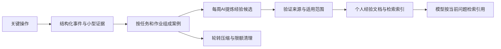

# 从操作记录形成个人经验

2026-10-26：待办第三项的实现评估与建议方案，尚未实施或启用自动学习。本轮只发布归档端点与创建后参数同步修复。

目标是让后续模型能参考用户已经做过的判断，减少反复解释。建议做有来源、可纠正的经验检索（RAG），不进行模型权重训练，也不把历史偏好转成作业执行授权。

## 已有基础和真实缺口

| 已有实现 | 可复用部分 | 缺口 |
| --- | --- | --- |
| `routers/jobs._audit_log`、`automation.audit.write`、`auth.audit` | 统一写入 `data/audit/actions.jsonl`，区分人工/自动化；账号事件也在同一文件 | 字段不统一，缺事件ID、操作前后差异、原因和后续结果关联；归档、草稿编辑等关键动作覆盖不全 |
| `parameter_history` | 最近5次实际上传/续算/提交参数，区分草稿和生效输入 | 不能依赖5条滚动缓存支持一周学习，需在动作发生时冻结小型差异证据 |
| `task_context` | 当前任务最近操作与巡检汇总 | 不等于完整工作历史；近期操作只提供上下文，没有经验提炼 |
| `report_store` 的 structured 副本 | 报告规范化数值与来源 | 当前只是存储，没有向量化或检索链路 |
| `ai_workspace` 的 knowledge 文件入口 | 人工公共知识只读 | 没有个人经验索引；该入口是共享目录，不能放私有操作记录 |

现有审计无自动轮转。检查时 `actions.jsonl` 约10 MiB、旧提交文本约0.44 MiB；部分读取使用 `readlines()`，增长后会重复全量读文件。旧提交文本还服务于提交次数统计，不能直接每周清空，否则会改变仪表盘历史口径。

## 建议的数据链路

### 1. 在已有业务成功点记录，失败也留痕

统一追加函数，继续兼容现有审计字段和自动化决策页，不另做任务状态库或执行器。覆盖创建/导入、参数草稿/撤销、实际上传、派生计算创建、提交/停止/续算、归档/恢复、用户对AI建议的采用/修改/拒绝。每个事件包含：

- 事件ID、时间、操作者、所属用户、项目/任务/任务族、作业ID、来源目录、动作类型和关联请求ID。
- 最小操作前后差异：参数的旧值/新值、草稿或已写入输入、结构hash、状态转换；不存整份POTCAR、OUTCAR或结构文件。
- 用户明确表达的原因原文及其来源；没有原因就记未知，模型不能补造动机。
- 实际结果阶段：请求失败、文件已写、LSF受理、运行结束、电子/离子收敛各自分开。提交成功不能称为科学验证成功。

在现有事务/动作结果处冻结小型证据，避免从当前文件倒推过去。操作重复回执按请求ID去重，后台轮询不当作新的人工操作。后续巡检通过任务族、目录、job_id、参数hash和时间关联结果；身份不一致就保留“结果未知”，不猜是哪次操作起效。

账号认证事件继续作审计；密码、token、IP、完整脚本和模型隐藏推理不进入学习材料。日志内容始终是数据，不能成为新的系统指令。

### 2. 先形成案例，再总结偏好

案例单位是“当时遇到什么 → 用户做了什么 → 后来看到什么”，而不是一条点击日志。一个任务的多次修改合成一个案例，同时保留关键分支和失败尝试。

每条经验记录类型（明确偏好/操作惯例/排错案例/科学观察）、适用体系与任务阶段、前提、操作、可核对结果、限制、来源事件ID与冻结事实、置信度、版本及替代关系。

明确偏好可直接记为用户偏好；仅由重复行为推测的偏好保持候选。例如“某次用POTIM=0.1后收敛”只能作为该体系的一条观察，不能推广为所有体系都应使用0.1，也不能推出因果关系。临时试错、不合理结果和失败案例不丢弃，但不得变成成功配方。最新明确指令优先于旧经验，矛盾经验保留适用条件/版本，模型不能自行把旧偏好覆盖成新规则。

用户能查看本周学习摘要，修改、停用或删除单条经验；被停用经验立即从检索排除。模型检索的是上下文参考，不是自动执行指令。

### 3. 每周处理与空间上限

建议默认值（实施时放设置页）：

| 数据层 | 保留与上限 |
| --- | --- |
| 活跃详细事件 | 按天分片，保留最近7天；单片达到16 MiB即轮转 |
| 压缩原始事件 | 每周处理后保留最近4周，压缩总量上限256 MiB |
| 案例证据与经验文档 | 长期小型留存，去重、版本替代；总量上限128 MiB，接近上限时明确提示整理，不静默删除用户确认的知识 |
| 每日操作计数 | 长期聚合，不包含敏感内容；清理原始提交文本前先迁移统计读口，保证历史提交计数不消失 |

周期内先稳定分片、构建案例、写入并校验经验/索引，最后才按保留期和空间额度清理。活动分片不能边写边截断；三种审计写入器共用锁/轮转边界，增量游标必须持久化，服务重启不会重复学习或漏写。

AI或索引失败不能提前删除尚未处理的原始记录；空间达到硬上限时停止累积新的学习候选并在界面提示，仍保留精简操作审计，不无限重试/增长。原始证据过期后保留冻结小型事实、来源ID、hash和过期标记；不能继续声称原始全文仍可回溯。

周任务在原应用维护调度中执行，建议周一凌晨，错过后启动时只补做一次。不新增Codex个人自动化，也不创建第二个生产writer。用户选择用于学习的私有模型连接、明确启用后才发模型请求；设单周输入/输出token上限、最大案例数、最大调用数与一次重试上限，记录用量与失败，不自动更换连接或模型。

### 4. 按问题检索，避免每轮灌入全部历史

增加原工作台只读工具 `search_work_experience(query, project_id?, task_type?)`，在讨论类似故障、参数策略或工作习惯时按需调用。先按当前已鉴权用户和可访问项目过滤，再搜索；不能先跨用户搜索后只过滤展示。个人经验独立于共享 `knowledge/`，不会通过文件浏览入口泄露。

首版建议SQLite FTS全文检索加结构化筛选/排序，不强依赖外部向量服务。中文需要验证当前SQLite支持FTS5 trigram；不支持时使用明确的中文字符切分/双字索引，不能直接用默认unicode分词后宣称中文检索有效。后续再按评测结果加向量索引，向量同样按用户/项目隔离。

检索结合材料体系、计算类型、问题、参数与阶段，优先用户明确确认且条件匹配的经验，每次最多5条，返回适用范围、来源ID、结果、置信度及原始证据是否已过期。模型回答应说明参考了哪条历史经验；没有匹配项就说没有，不把弱相关旧案例硬套到当前结构。

## 建议的分期和验收

第一期先接统一事件、完整记录关键操作、每周轮转与查询页，兼容旧审计和提交计数。第二期接案例提炼、AI候选文档、用户纠正/停用和RAG工具。两期各自可发布，不先上大型Agent框架或训练流水线。

验收使用临时data、Mock模型/SSH，至少验证：事件成功/失败/重复及前后差异；同目录不同job不串案例；重启游标与并发轮转不丢记录；清理失败和空间上限；草稿不假称已应用；账号敏感信息不入学习材料；中文相关/无关查询；跨用户/跨项目拒绝；经验停用、相互矛盾与最新用户指令优先；模型不可用不影响正常提交/巡检。真实启用后单独记录实际周处理和检索验收，不能用Mock结果冒充已学习完成。
